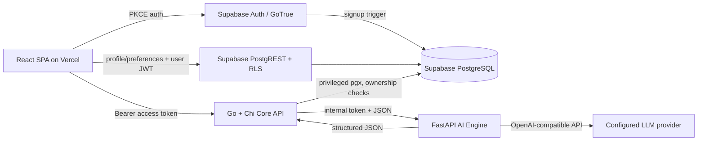
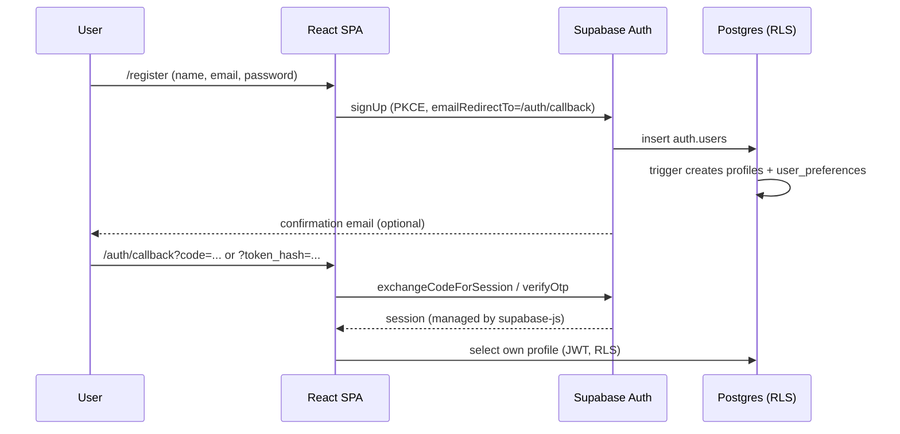

# Architecture

**Implemented:** React/Vite SPA + Supabase Auth/PostgreSQL + Go Core API + Python AI
Engine. Phase 02 authentication/profile flows remain in place; Phase 03 adds the AI Course
Architect.



The important boundary: **the browser never calls an LLM, and the AI Engine never writes
course data.** The Go Core API owns authorization and persistence.

## Phase 02 (kept working)

### Auth flow



- **PKCE** is configured explicitly; `detectSessionInUrl` is off so redirects are handled
  once, by `/auth/callback` (email links) and `/reset-password` (recovery links).
- supabase-js owns persistence, refresh and token storage. The app never reads, copies or
  forwards access/refresh tokens.
- `AuthProvider` is the only auth listener. Route guards are UX only; RLS is the data
  boundary for direct Supabase access.
- The web client reads only `VITE_SUPABASE_URL` and
  `VITE_SUPABASE_PUBLISHABLE_KEY`. The legacy `VITE_SUPABASE_ANON_KEY` name is no longer
  read, preventing a secret-prefixed value from being embedded by Vite.

### Frontend structure

```text
apps/web/src/
├── app/
│   ├── guards.tsx              ProtectedRoute, PublicOnlyRoute
│   ├── router.tsx              route table, lazy page chunks
│   └── providers.tsx           QueryClient + auth providers
├── components/
│   ├── auth/AccountMenu.tsx
│   ├── brand/Mark.tsx
│   ├── system/RouteStates.tsx  full-page loader, setup screen
│   └── ui/                     Phase 01/02 UI kit
├── features/
│   ├── auth/                   AuthProvider, auth API, schemas, forms
│   ├── profile/                typed Supabase profile/preferences API
│   └── course/
│       ├── api/                Core API client, Zod envelopes, query keys
│       ├── hooks/              TanStack Query hooks/mutations
│       ├── schemas/            Zod response + intake schemas
│       └── components/         cards, badges, timeline, provider notice
├── lib/
│   ├── supabase.ts             single browser client
│   ├── database.types.ts       Phase 02 schema types
│   └── redirects.ts            open-redirect protection
├── pages/
│   ├── auth/                   Login, Register, Forgot, Reset, Callback
│   └── app/                    AppLayout, Dashboard, Courses, NewCourse,
│                               Diagnostic, DiagnosticResult, Generating,
│                               CourseReview, CourseDetail, Settings
└── test/setup.ts
```

## Phase 03 flow

### Course Architect lifecycle

```mermaid
sequenceDiagram
  participant U as User
  participant SPA as React SPA
  participant API as Go Core API
  participant AI as Python AI Engine
  participant LLM as LLM Provider
  participant DB as Postgres

  U->>SPA: Goal intake
  SPA->>API: POST /learning-goals (Bearer JWT)
  API->>DB: insert learning_goals (user_id from JWT)
  U->>SPA: Start diagnostic
  SPA->>API: POST /learning-goals/{id}/diagnostic
  API->>AI: diagnostic/generate
  AI->>LLM: structured JSON request
  LLM-->>AI: questions + private keys
  AI->>AI: Pydantic + deterministic validation (one repair)
  AI-->>API: validated question set + answer keys
  API->>API: Go structural validation
  API->>DB: questions, answer keys, goal=diagnostic_ready
  U->>SPA: Answer all questions
  SPA->>API: POST .../diagnostic/submit
  API->>AI: diagnostic/evaluate (keys stay server-side)
  AI-->>API: level, strengths, gaps, feedback
  API->>DB: evaluation, goal=diagnostic_evaluated
  U->>SPA: Generate curriculum
  SPA->>API: POST /learning-goals/{id}/generate
  API->>DB: row lock, goal=generating
  API->>AI: course/generate (goal + diagnostic; no keys)
  AI->>LLM: structured blueprint
  AI->>AI: validate ids, references, prerequisites, cycles, sizes
  AI-->>API: validated blueprint + metadata
  API->>API: validate.Curriculum again
  API->>DB: course + version 1 draft, goal=course_draft
  U->>SPA: Review / edit / regenerate
  SPA->>API: PATCH draft or POST regenerate
  U->>SPA: Approve
  SPA->>API: POST /courses/{id}/approve (version_id)
  API->>DB: supersede old approved, approve new, enroll (transaction)
```

### Generation state

- Course generation takes a Postgres row lock on `learning_goals` (`BeginGeneration`).
  A live lock returns `409 generation_in_progress`; a lock older than
  `GENERATION_STALE_SECONDS` may be reclaimed after a crash.
- The model call runs with a context detached from the browser request. Refreshing or
  leaving the page does not abort work the database already considers running.
- The UI polls `GET /learning-goals/{id}` every 2.5 s while status is `generating`. It
  never invents a percentage.
- A failed first generation sets `failed` and a safe `last_error`, enabling retry. A
  failed regeneration restores `course_draft`/`approved` when a course still exists, so the
  review page remains usable.
- `courses.approved_version_id` separates the live curriculum from a newer draft under
  review. A partial unique index permits one approved version per course. Approval is
  idempotent and also upserts enrollment.

### Validation layers

1. **Frontend Zod** — request/response shape and form-level input.
2. **Go input validation** — normalization, lengths, enums, UUIDs, answer coverage,
   draft-edit ownership/state.
3. **Python Pydantic** — strict generated schemas (extra fields forbidden, bounded lists
   and strings).
4. **Python deterministic validators** — duplicate ids, contiguous sequences, reference
   integrity, prerequisite ordering, cycles, duration/volume consistency, URL/citation
   rejection.
5. **Go structural validation** — the Core API does not trust the AI service blindly; it
   re-checks ids, references, cycles and required content before persistence.
6. **Database constraints** — enums, lengths, JSON types, unique sequences, one approved
   version per course.

Malformed output triggers one repair prompt in Python. If repair fails, the request fails
with `invalid_generated_content`; nothing is persisted.

## Backend boundary

| Layer | Owns | Never does |
|---|---|---|
| Supabase Auth | Identity, password hashing, email confirmation, recovery, sessions. | Course business logic. |
| PostgREST + RLS | User isolation for direct browser access to Phase 02 tables and read-only Phase 03 learning data. | Write learning data for the browser. |
| React SPA | Presentation, routing, form UX, polling, safe error copy. | Call an LLM directly; hold service keys; trust frontend user ids. |
| Go Core API | JWT/JWKS verification, ownership, validation, course/version/diagnostic writes, approval, enrollment, generation lock. | Generate content with an LLM; expose answer keys. |
| Python AI Engine | Provider abstraction, prompts, structured generation, schema/structure validation, repair, safe errors. | Read/write the database; authorize end users. |
| PostgreSQL | Persistence, constraints, RLS, transaction boundaries. | Decide UX/navigation. |

## Data access and ownership

- The Go API reads the caller's user id from the verified JWT `sub`; a frontend-supplied
  id is never accepted.
- Every query and mutation includes the user id predicate, including nested content loads.
- The Go service uses a privileged database connection (RLS bypass by role), so the
  ownership predicates are the application boundary. RLS separately protects direct
  browser/PostgREST access.
- `diagnostic_answer_keys` has no grants to `anon`/`authenticated`; questions serialize
  without `explanation`.
- The AI Engine receives only the current user's goal/diagnostic context and the internal
  shared token; it has no database connection.

## Failure and safety behavior

- Safe errors: provider bodies/secrets are not returned to the client. Errors use a stable
  code/message envelope with `X-Request-ID`.
- Timeouts: configurable in both services; the frontend uses longer generation timeouts
  than the Core API, which in turn bounds the AI call.
- Retries: transient provider errors only, bounded; validation failures get one repair
  attempt, not unlimited retries.
- Fallback: only when explicitly configured, recorded in metadata; a mock fallback is
  rejected in production.
- Size limits: request bodies, JSON input, output tokens/bytes, course bytes and nested
  counts are bounded.
- Prompt-injection resistance: user text is delimited in prompts and the system prompt
  states that embedded instructions are data, not commands.

## Authenticated workspace

`/app/*` renders inside `AppLayout` (collapsible sidebar, mobile drawer, breadcrumb topbar, search, account menu). Feature code lives in `apps/web/src/features/workspace/`; pages in `apps/web/src/pages/app/`. Course pages read through `useCourseView`, which serves either the real course (TanStack Query) or the labelled built-in demo course (`id = "demo"`). No lesson-progress or tutor backend exists, so those surfaces display plan data only or an honest "not connected" state. Details: `docs/APP_WORKSPACE.md`.

## Not implemented

- OAuth/social sign-in, magic links, MFA.
- Email change, avatar upload, account deletion UI.
- Lesson playback, assessment attempts, unlock enforcement, AI tutor, analytics,
  payments, multi-user administration.
- Audit logging and a full CSP/security-header deployment posture.
